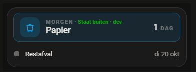

# 0.62.2: het infoscherm na een herstart, de laadpaal op een iPhone, en wie de bak buiten zette

## De vraag

Drie berichten van de eigenaar op 12 oktober 2026:

1. *"als ik een ipad aan de muur heb hangen die 24/7 aan staat wat doet hij
   met de nieuws feed? Update hij automatisch of hoe gaat dat? Blijven de
   artikelen zo staan tot je handmatig ververst? Want dat moet niet het geval
   zijn"*
2. Met een schermafdruk van zijn telefoon: *"bij de laadpaal kaart overlappen
   de klaar om blokken"*. Het tijdveld "Klaar om" liep over het minknopje van
   "Laden tot".
3. *"als ik met een notificatie actie van het afval klik van staat aan staart
   dan komt hij onder de notificatie meldingen te staan maar op de afvalkaar
   wil je juist hebben staan door wie die aan de straat is gezet"*

## 1. Het nieuws op een iPad die altijd aan staat

**Zo hoort het te gaan, en zo gaat het ook:** de server haalt elke RSS-bron
elk kwartier op (`FEED_INTERVAL`, en meteen bij het opstarten) en stuurt het
resultaat naar elk scherm dat geabonneerd is. Het scherm tekent het nieuws dan
opnieuw, zonder herladen.

**Behalve na een herstart van Home Assistant.** Na het opnieuw verbinden vroeg
de kaart het abonnement meteen weer aan. Maar op dat moment kent Home
Assistant onze commando's nog niet (valkuil 28). Het aanvragen mislukte stil,
en niemand probeerde het opnieuw. Daarna kwam er niets meer binnen: geen
nieuws, geen mededeling en geen aanmelding, tot iemand de pagina herlaadde.
Precies wat hij niet wilde.

### Gemeten

Testinstance op 8127, Chrome. Als proef zet ik een medewerker op aanwezig via
de server; de kop van het blok Aanwezig hoort dan mee te veranderen. Na elke
herstart is de kaart OPNIEUW opgezocht, want Home Assistant bouwt hem dan op
als een nieuw element (zie valkuil 70).

| | vóór de herstart | na de herstart |
|---|---|---|
| 0.62.1 (`406fce809480`), pagina geladen om 20:03:05 | "3 van 8" → "4 van 8" | server "3 van 8", scherm bleef "4 van 8" |
| 0.62.2 (`c780a083c2bc`), pagina geladen om 20:04:30 | "3 van 8" → "4 van 8" | "3 van 8" → "4 van 8", gelijk aan de server |
| 0.62.2, het nieuws | | lijst op het scherm leeggemaakt, de server de feeds laten ophalen: het scherm kreeg vanzelf 15 berichten terug |

In geen van beide gevallen is de pagina herladen; dat staat in
`performance.timeOrigin`.

### De reparatie

`BlijvendAbonnement` in `src/herkansing.js`:

- **Mislukt het abonneren omdat Home Assistant nog opstart**
  (`nogNietGereed`), dan wordt het opnieuw geprobeerd met de wachttijden van
  `Herkansing`. Dat houdt niet op.
- **`resubscribe: false`.** De bibliotheek van Home Assistant abonneert dan
  niet zelf opnieuw; de kaart doet dat vanuit de hass-setter bij een
  herverbinding. Zo is er nooit meer dan één abonnement.
- **Een nieuwe `start` zegt het vorige abonnement eerst op.**

Het infoscherm en het infoschermbeheer gebruiken het (`Abonnement` in
`infoscherm-client.js` is een dunne schil eromheen). De beheerpagina bij een
receptie, die de hele dag openstaat, had dezelfde fout.

## 2. Het tijdveld op de laadpaalkaart

In Chrome is er geen overlap. Gemeten in `dev/laadpaal.html` op 380, 320 en
280 px: het tijdveld is precies zijn kolom (171, 141 en 121 px), met 8 px tot
"Laden tot". Het is dus Safari op iOS. Daar heeft een
`<input type="time">` een eigen vorm met een eigen minimale breedte, en die
trekt zich niets aan van `width: 100%`.

**De reparatie, in twee lagen:**

1. `appearance: none` (met `-webkit-`) en `display: block`: dan volgt het veld
   de breedte. Daarbij `::-webkit-date-and-time-value` zonder marge en in het
   midden.
2. Het vak eromheen (`.veld.klaar`) knipt af wat er toch nog uitsteekt. De
   focusring staat daarom naar binnen (`outline-offset: -2px`), anders valt
   die weg.

**Gemeten in Chrome (geen achteruitgang):** dezelfde maten, `appearance: none`,
de waarde blijft 06:00. Een echte klik op het uur en de echte toetsaanslagen
`0730` (alle vier `isTrusted: true`) gaven 07:30, en de kaart stuurde
`time.set_value` met `07:30:00`.

**Niet gemeten op een iPhone.** Dat kan hier niet; dat ligt bij hem.

## 3. Wie de bak buiten zette, op de afvalkaart

De server onthield het al (`buiten` in `meldingen/store.py`: voor welke
ophaaldag, en door wie). Alleen de meldingenkaart toonde het.

Nu abonneert de afvalkaart zich op dezelfde melding (`afval`, of `melding:` in
de YAML voor een andere id), met hetzelfde `BlijvendAbonnement`. Is de bak van
het uitgelichte vlak buiten gezet, dan:

- staat er in de regel boven de namen *"Morgen · Staat buiten · Sven"*. Het
  is groen (een status), en de naam staat er zoals hij heet, niet in
  hoofdletters;
- knippert het vlak niet meer, ook niet op de dag zelf: het is gedaan;
- de kaart wordt niet hoger. Het staat in een regel die er al was, en een
  afvalkaart heeft een vast aantal rasterrijen;
- in de brede vorm staat het bij de bak zelf, in plaats van "morgen".

Op de meldingenkaart blijft het OOK staan. Daar legt het uit waarom de
ochtendmelding niet komt.

**Gemeten:** een afvalkaart met Papier morgen en Restafval later, met de hand
in de pagina gehangen (valkuil 21). Het event van de telefoonknop is
nagespeeld met `fire_event` (`mobile_app_notification_action`,
`DOMOTIAPP_AFVAL_BUITEN|afval|<morgen>`) als de ingelogde gebruiker:

| | gemeten |
|---|---|
| de regel boven "Papier" | "morgen · Staat buiten · dev" (CSS zet "morgen" in hoofdletters, de rest niet) |
| kleur | `rgb(12, 163, 12)` (`--dac-good`) |
| `urgency` | `buiten` (dus geen knipperen) |
| hoogte van de kaart | 120 px, twee rasterrijen, zoals ervoor |



## Tests

`npm test`: 1561 groen. `verify`, `check:registratie`, `check:controls` en
`check:css` zijn groen. Python: niet gewijzigd; draait in CI.

**NIEUW GEDRAG:**

- `tests/js/infoscherm-client.test.mjs`, `Abonnement` (4): opnieuw proberen
  zolang Home Assistant opstart, `resubscribe: false`, de vorige opzeggen,
  stoppen, en geen herhaling bij een andere fout. Op de code van ervoor faalt
  het bestand bij het importeren (`Abonnement` bestond niet). Het GEDRAG is
  hierboven in de browser tegen 0.62.1 gemeten.
- `tests/js/afval-buiten.test.mjs` (4): de tekst, de voornaam, een andere
  ophaaldag, niets van de server. Faalt op de code van ervoor bij het
  importeren.

De CSS van de laadpaal heeft geen unittest (geen jsdom). Die is in Chrome
gemeten, maar niet op de plek waar de fout zat.

## Samenvatting

- **Het infoscherm en het beheer blijven na een herstart van Home Assistant
  bijwerken.** Tot nu toe bleef het nieuws (en de rest) staan tot iemand
  herlaadde. Gewoon ververst het nieuws elk kwartier vanzelf.
- **Het tijdveld op de laadpaalkaart kan op een iPhone niet meer over "Laden
  tot" heen lopen.**
- **De afvalkaart zegt wie de bak buiten zette.**

## Wat niet lukte

- **De laadpaalkaart op een echte iPhone.** De fout zit in Safari en is hier
  niet na te bootsen. De reparatie is gebouwd op wat Safari met een
  time-input doet, en het afknippen is een vangnet als dat niet genoeg is.
  Hij moet het op zijn telefoon bekijken.
- **De andere tijdvelden** (de wekkereditor, de openingstijden in het beheer)
  hebben dezelfde soort invoer. Daar is niets over gemeld en ze zijn niet
  aangepast.

## Aannames

- "Door wie die aan de straat is gezet" moet ERBIJ op de afvalkaart, niet weg
  van de meldingenkaart.
- De afvalkaart volgt de melding met id `afval`. Wie op de meldingenkaart een
  eigen `id` heeft gezet, zet die als `melding:` in de YAML van de afvalkaart.
  Dat staat niet in de editor.

## git status --porcelain

Vóór de commit:

```
 M CLAUDE.md
 M custom_components/domotiapp_lovelace/frontend/domotiapp-lovelace.js
 M src/cards/afval-logica.js
 M src/cards/laadpaal-card.js
 M src/cards/waste-card.js
 M src/herkansing.js
 M src/infoscherm-client.js
?? docs/abonnement-laadpaal-en-afval/
?? tests/js/afval-buiten.test.mjs
```
