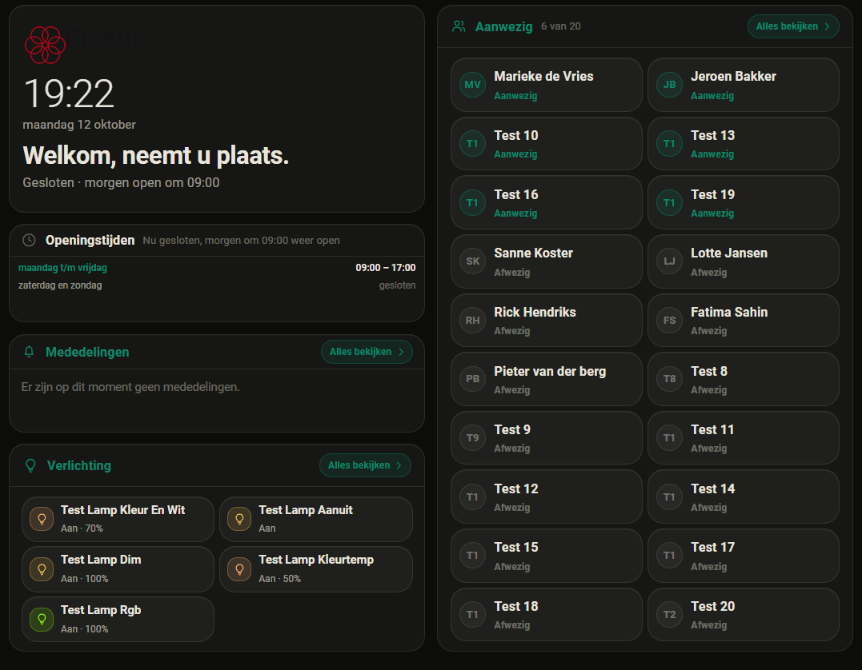

# 0.62.0: infoscherm, de lampen in volgorde, de hele week, en wie er is

## De vraag

Vier meldingen van de eigenaar op 12 oktober 2026, allemaal met een
schermafdruk van het infoscherm van een klant:

1. *"ik wil de indeling van de verlichting kunnen aanpassen (...) in beheer
   staat dat nu alleen maar onder elkaar dat niet aan te passen is."* Op de
   schermafdruk staan de lampen in een vaste volgorde.
2. *"als ik geen mededeling heb dan moet hij dat zo zeggen nu is het vak dan
   helemaal leeg"*
3. Bij een blok Openingstijden van één rij met maandag, dinsdag, woensdag en
   "nog 4": *"ik wil alles op de kaart kunnen zien is dat mogelijk? Dus elke
   dag"*
4. Bij een aanwezigheidsblok met 20 tegels en alleen namen: *"waarom wordt er
   niet aanwezig of afwezig laten zien?"*

## Wat er mis was, en wat er nu is

### 1. De volgorde van de lampen

In het beheer stonden de lampen onder elkaar, zonder greep. De volgorde was die
van de kaartconfig, en daar kon de receptie niet bij. Er was ook nog een
tweede, stillere fout: de beheerkaart synchroniseert zijn kaartconfig zodra een
beheerder hem opent. Die vergelijking ging op VOLGORDE, en de server nam de
volgorde van de config over. Een eigen volgorde zou dus bij het volgende bezoek
van de installateur verdwenen zijn.

Nu:

- elke lamp heeft in het blok Verlichting een greep, net als de medewerkers,
  en slepen is de volgorde op het scherm;
- de server laat de receptie de volgorde wijzigen. Lampen toevoegen of
  weghalen kan ze nog steeds niet;
- de synchronisatie vergelijkt de lampen als verzameling. De server houdt bij
  een synchronisatie de opgeslagen volgorde aan, een nieuwe lamp gaat achteraan
  en een weggehaalde verdwijnt (`_in_volgorde_van` in `store.py`).

### 2. Geen mededeling

Een mededelingenblok zonder geldige mededeling ging van het scherm af
(`blokOntbreekt`), en dan bleef er een gat in het raster. Nu blijft het blok
staan, met *"Er zijn op dit moment geen mededelingen."*. Verlopen mededelingen
worden nog steeds niet getoond; dat was zijn keuze op 29 september.

### 3. De hele week

Het blok toonde de week dag voor dag. Paste dat niet (in een blok van één rij
gaan er drie in), dan vielen de dagen onderaan weg, met "nog 4" in de kop.

Nu staat de week er twee keer in de html: dag voor dag, en met de opeenvolgende
dagen met dezelfde tijden samen (`openingsGroepen`). Het blok toont de dagen
als ze passen (eventueel tot 72% verkleind, zoals eerst). Passen ze niet, dan
toont het de groepen:

- *maandag t/m vrijdag 09:00 – 17:00*
- *zaterdag en zondag gesloten*

Een dag met een uitzondering (een reden) blijft apart staan. In twee kolommen
(een breed blok) heten de groepen "ma–vr" en "za, zo".

Daarbij de kop. Om 19:00 op een maandag van 09:00 tot 17:00 stond er *"Vandaag
gesloten"*. Nu staat er *"Nu gesloten, morgen om 09:00 weer open"*
(`openingKop`). "Vandaag gesloten" staat er alleen nog op een dag zonder
openingstijden.

### 4. Aanwezig of afwezig

Paste het blok niet met de gewone tegels, dan sprong het naar "dicht": kleinere
tegels, zonder functie EN zonder status. Met 20 medewerkers in een blok van 2x6
gebeurde dat, en daarna werden de tegels over de hoogte uitgesmeerd tot 66 px.
Er was dus ruim plek voor de status, maar die stond er niet.

Nu zit er een stap tussen: **halfdicht**. Dat zijn dezelfde compacte tegels,
maar alleen de functie gaat eraf; Aanwezig/Afwezig blijft staan. Het blok kiest
de eerste vorm waarin iedereen past: gewoon, halfdicht, dicht.

## Gemeten in de browser

Testinstance op 8127, Chrome, het tabblad verborgen (de eigenaar werkte in een
ander venster). De geladen bundel `?v=5fb2d28629e6` was gelijk aan schijf. De
container is herstart, omdat er Python gewijzigd was (valkuil 49).

De situatie van de klant is nagebouwd:

- 20 medewerkers, waarvan 6 aanwezig, in een aanwezigheidsblok van 2x6;
- een werkweek van 09:00 tot 17:00 in een openingstijdenblok van één rij;
- geen mededelingen;
- vijf lampen in de kaartconfig van de beheerkaart.

Daarna zijn de testgegevens teruggezet.

**De lampen, met echte pointer-events:**

| stap | gemeten |
|---|---|
| synchronisatie vanuit de kaartconfig | aanuit, dim, kleurtemp, rgb, kleur_en_wit |
| klik op de kop Verlichting | `isTrusted: true`, het blok gaat open |
| "Kleur En Wit" aan zijn greep naar boven gesleept | `pointerdown trusted=true` op de greep, `pointerup trusted=true` |
| daarna, op het beheer en in de opslag | kleur_en_wit, aanuit, dim, kleurtemp, rgb ("Opgeslagen 19:21") |
| beheer herladen als beheerder | niet gesynchroniseerd, de volgorde staat er nog |
| op het scherm | Kleur En Wit, Aanuit, Dim, Kleurtemp, Rgb |

**Het scherm:**

| blok | gemeten |
|---|---|
| Aanwezig | `halfdicht`, 20 tegels, 0 verborgen, de status op alle 20 zichtbaar, de functie op 0; een tegel is 240 x 67; de kop zegt "6 van 20" |
| Openingstijden | de dag-voor-daglijst verborgen, de groepen zichtbaar: "maandag t/m vrijdag 09:00 – 17:00", "zaterdag en zondag gesloten"; de kop zegt "Nu gesloten, morgen om 09:00 weer open" |
| Mededelingen | staat op het scherm, met "Er zijn op dit moment geen mededelingen." |



## Tests

`npm test`: 1554 groen. `verify`, `check:registratie`, `check:controls` en
`check:css` zijn groen. Python: 793 groen (in Docker).

**NIEUW GEDRAG:**

- `tests/js/infoscherm-openingstijden.test.mjs` (6): de groepen, de
  kolomvolgorde en de kop. Faalt op `main` bij het importeren
  (`does not provide an export named 'kolomVolgorde'`).
- `tests/js/infoscherm-logica.test.mjs`: een mededelingenblok ontbreekt niet
  meer zonder mededeling. Op `main`:
  `actual: 'Geen mededeling die nu geldt', expected: null`.
- `tests/infoscherm/test_store.py`: de receptie zet de lampen in haar eigen
  volgorde, en de kaartconfig laat die staan. Op `main`:

  ```
  E       AssertionError: assert ['light.a', '...b', 'light.c'] == ['light.c', '...a', 'light.b']
  FAILED tests/infoscherm/test_store.py::test_de_kaart_stuurt_zijn_installatie_en_de_namen_blijven
  FAILED tests/infoscherm/test_store.py::test_de_receptie_zet_de_lampen_in_haar_eigen_volgorde
  FAILED tests/infoscherm/test_store.py::test_de_kaartconfig_laat_de_volgorde_van_de_receptie_staan
  3 failed, 36 passed
  ```

**Een bestaande toets is met opzet aangepast:**
`test_de_kaart_stuurt_zijn_installatie_en_de_namen_blijven` verwachtte dat een
nieuwe lamp uit de config vóór een bestaande kwam, in de volgorde van de
config. Nu gaat een nieuwe lamp achteraan; dat staat bij de verwachting.

Halfdicht en het wisselen tussen dag voor dag en groepen gebeurt in `pasBij_`.
Dat is meten in de browser en heeft geen unittest (geen jsdom).

## Samenvatting

- In het beheer kun je de lampen verslepen, en dat is de volgorde op het
  scherm. Die blijft ook staan als de installateur het beheer opent.
- Een mededelingenblok zonder mededeling zegt dat, in plaats van te
  verdwijnen.
- Het blok Openingstijden toont elke dag. Past de week dag voor dag niet, dan
  worden gelijke dagen samengevoegd. De kop zegt na sluitingstijd
  "Nu gesloten, morgen om 09:00 weer open".
- Bij veel medewerkers blijft Aanwezig/Afwezig op de tegels staan.

## Wat niet lukte

- **Slepen als receptieaccount** (geen beheerder) is niet in de browser
  gemeten. De testinstance heeft na het herstel geen tweede gebruiker. De
  serverkant daarvan staat in de Python-toetsen; in de browser is gesleept
  als beheerder.
- **Een echte iPad**: niet gemeten.
- **Zeven verschillende dagen in een blok van één rij** passen nog steeds
  niet. Er valt dan niets samen te voegen, en er vallen onderaan dagen weg met
  "nog N" in de kop. Groter maken in Indeling helpt dan.

## Aannames

- "De indeling van de verlichting" is de VOLGORDE van de lampen. Niet welke
  lampen erop staan (dat kiest de installateur), en niet de plek van het blok
  (dat is Indeling van het scherm).
- Halfdicht laat de functie weg en houdt de status. Hij vroeg naar de status,
  niet naar de functie.
- "Elke dag" mag als groep: "maandag t/m vrijdag" noemt elke dag, en past
  waar zeven regels niet passen.

## git status --porcelain

Vóór de commit van het rapport (de code stond al deels in de tak):

```
 M custom_components/domotiapp_lovelace/frontend/domotiapp-lovelace.js
 M custom_components/domotiapp_lovelace/infoscherm/store.py
 M custom_components/domotiapp_lovelace/manifest.json
 M src/cards/infoscherm-beheer-card.js
 M src/cards/infoscherm-card.js
 M src/cards/infoscherm-logica.js
 M tests/infoscherm/test_store.py
 M tests/js/infoscherm-logica.test.mjs
?? docs/infoscherm-lampen-week-en-status/
```
