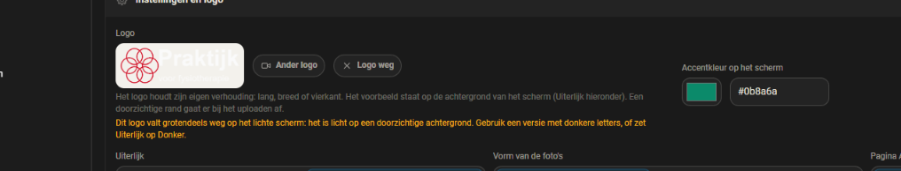

# 0.61.0: het logo op het infoscherm

## De vraag

Een beheersessie meldde op 12 oktober 2026 dat het logo van een klant niet op
de iPad verscheen, terwijl het wel in Tablet Beheer was geüpload. Er kwamen
drie voorstellen mee:

1. het voorbeeld in het beheer op de achtergrond van het scherm laten zien, en
   waarschuwen als het logo daar wegvalt;
2. de doorzichtige rand bij het uploaden wegsnijden;
3. een vermoeden: het token in `infoscherm-client.js` verloopt na een half uur,
   en daarna komt een nieuw logo of een nieuwe foto niet meer binnen.

Hun eerste diagnose was contrast: zwarte letters op een doorzichtige
achtergrond, op een donker scherm. **Een uur later kwam er een correctie.** De
eigenaar had het scherm op Licht gezet en zag nog steeds niets. De beheersessie
mat het na in Chrome op het tabletdashboard van de klant: de oorzaak zat in de
CSS van `.logo`.

## Wat er mis was, gemeten

### Het logo stond in een vak dat alleen de lege bovenrand toonde

`.logo` was een grid-vak (`display: grid; place-items: center; overflow:
hidden`) met een vaste hoogte. De `` erin had `height: 100%`. De rij van
dat grid is `auto`, en tijdens het bepalen van die rij telt de 100% als `auto`.
De rij werd daardoor zo hoog als het beeld op de volle breedte van het vak.

Nagemeten in de testinstance, in een welkomblok van 2x2 zoals bij de klant. Het
logo is nagebouwd: 1410x620, doorzichtig, zwarte letters, een rood beeldmerk
van dunne lijnen, en de tekening tussen 31% en 75% van de hoogte. Het is in het
vak gezet zoals `paintLogo_` dat doet:

| | voor (0.60.1) | na (0.61.0) |
|---|---|---|
| `.logo`, display | grid | flex |
| `.logo`, maat | 502 x 60 | 137,3 x 60,4 |
| grid-rij | 220,75 px | n.v.t. |
| `` | 502 x 221 | 137,3 x 60,4 |
| zichtbaar van het beeld | bovenste 27% (de tekening begint op 31%) | alles |
| de klok | zakt van y=144 naar y=179, onder een leeg vak | y=179, onder het logo |

**Dit treft elk liggend logo**, niet alleen dat van deze klant. Een logo zonder
lege rand verscheen als een afgesneden strook bovenin. Zonder rand en zonder
lege bovenkant viel het minder op, en dat verklaart waarom het tot nu toe niet
gemeld is.

Het voorbeeld in het beheer (`.plaatje.logo`) had hetzelfde patroon. Daar was
het vak 220x64 (56 px binnen de rand) en de `` 212x93: de onderste 40%
viel weg.

**De reparatie:** `.logo` en `.plaatje.logo` zijn flexvakken. Daarin lost de 100%
gewoon op tegen de vaste hoogte van het vak. Dit is valkuil 69 in CLAUDE.md.

### Het contrast speelde ook mee, maar was niet de oorzaak

Zwarte letters op `#0c0c0a` vallen weg. Op de schermafdruk van de testinstance
(Donker, na de CSS-reparatie) is het rode beeldmerk goed te zien en de tekst
bijna niet. Bij de klant is dat al opgelost met een versie met witte letters,
die de beheersessie heeft gemaakt.

### Het token verloopt, en de pagina ververst het niet

Bevestigd in de frontend van Home Assistant 2026.8 zelf (`hass_frontend` in de
container). Het token wordt alleen ververst:

- bij het (opnieuw) verbinden van de websocket;
- in `fetchWithAuth` (`e.expired && await e.refreshAccessToken()`), en
  `hass.fetchWithAuth` bestaat.

`infoscherm-client.js` las `hass.auth.data.access_token` rechtstreeks. Daar
ververst niemand iets.

**Gemeten in de browser:** zie *Het token, na een half uur* hieronder.

## Wat er veranderd is

| | |
|---|---|
| `src/cards/infoscherm-card.js` | `.logo` is een flexvak. Lukt het ophalen van het logo niet, dan gaat de wens eraf en probeert de volgende `paint` het opnieuw. Tot nu toe kwam het pas terug bij een paginalading, en op een iPad in kioskmodus komt die er niet. Avatars die niet geladen werden, krijgen `data-opnieuw` en ook een nieuwe kans. |
| `src/infoscherm-client.js` | `haal()` gaat via `hass.fetchWithAuth`, die het token eerst ververst. Zonder die functie (een nagebootste `hass`) ververst `haal()` het zelf. Uploaden en ophalen gaan er allebei doorheen. Een bestand dat niet opgehaald kon worden, krijgt 30 seconden rust (`RUST_NA_FOUT`), anders zou het scherm het bij elke toestandswijziging opnieuw vragen. |
| `src/cards/infoscherm-logo.js` (nieuw) | het rekenwerk, zonder DOM: het kader van de zichtbare pixels, de lucht eromheen, of bijsnijden loont, en hoeveel van een doorzichtig logo wegvalt op elk van de twee achtergronden |
| `src/cards/infoscherm-logo-beeld.js` (nieuw) | het canvaswerk: bijsnijden (alleen PNG en WebP; een GIF kan bewegen en een SVG is geen raster) en meten |
| `src/cards/infoscherm-beheer-card.js` | het voorbeeld staat op de achtergrond van het scherm (`#0c0c0a` of `#f3f1ec`, volgens Uiterlijk) en wisselt mee zonder het blok opnieuw te tekenen. Eronder staat een waarschuwing als meer dan de helft van een doorzichtig logo wegvalt. Bij het uploaden gaat de doorzichtige rand eraf. |
| idem, bijvangst | de melding "... geüpload." was nooit te zien: `markeer_` wiste hem meteen weer. Nu staat hij er, met "De lege rand eromheen is weggesneden." erachter als dat zo is. |

Die twee kleuren staan op één plek (`SCHERM_ACHTERGROND`). De lichte waarde gaat
ook het scherm in, en een toets houdt de donkere gelijk aan `--dac-bg` uit
`theme.js`.

## Gemeten in de browser

Testinstance op 8127, HA 2026.8, Chrome. Het tabblad stond de hele ronde op
`hidden`: de eigenaar werkte in een ander venster, en het is niet naar voren
gehaald (valkuil 60). Schermafdrukken en echte kliks werkten wel.

**Verse code:** de geladen `?v=` was steeds gelijk aan de eerste twaalf tekens
van de sha256 op schijf (`51f720f2945e`, daarna `74c33be18ba7` en
`58368509ac60`). Na elke bouw is de config entry herladen met `hass.callApi`.
Daarna zijn de service worker en de caches gewist en is de pagina herladen.

**Bijsnijden, via de echte kaart:** het nagebouwde logo van 1410x620 werd
817x265. Het kader van de zichtbare pixels is 785x233, en daaromheen komt 16 px
lucht (2% van de lange kant). Op het scherm is het logo daarna 186,1x60,4, en
de `` is precies even groot. De tekening is 53,1 px hoog in plaats van
22,7 px (2,3 keer zo groot).

**Het voorbeeld in het beheer:**

| stap | gemeten |
|---|---|
| zwart logo, Uiterlijk Donker | achtergrond `rgb(12, 12, 10)`, `` 173x56 in een vak van 181x64 (4 px rand), waarschuwing *"Dit logo valt grotendeels weg op het donkere scherm ..."* |
| wit logo, Donker | geen waarschuwing; melding *"logo-wit.png geüpload. De lege rand eromheen is weggesneden."* |
| echte klik op **Licht** (`isTrusted: true`) | achtergrond `rgb(243, 241, 236)`, waarschuwing *"... op het lichte scherm ..."* in `rgb(250, 178, 25)`, opgeslagen |



**Ook bij het meten gevonden en gerepareerd:** de waarschuwing stond eerst in
het grijs van de hulptekst. `.hulp` staat later in de CSS en won bij gelijke
specificiteit; het is nu `.hulp.logo-waarschuwing`.

### Het token, na een half uur

Nog niet in de browser gezien. Het token van het testtabblad verloopt om 18:39,
en de uitgave wacht daar niet op: het gedrag is al vastgelegd in de unittests
(hieronder) en in de bron van de frontend (hierboven). De browsermeting komt
na de uitgave in dit rapport.

## Tests

`npm test`: 1547 groen (was 1528). `npm run verify`, `check:registratie`,
`check:controls` en `check:css` zijn groen. Python: 791 groen (in Docker,
`python:3.14-slim`).

**NIEUW GEDRAG**, `tests/js/infoscherm-logo.test.mjs` (14 tests): het kader, de
lucht, wanneer bijsnijden loont, en de analyse en de waarschuwing. Het logo van
de klant is daar op een tiende van de maat nagebouwd. Op de code van vóór deze
ronde faalt het bestand met `ERR_MODULE_NOT_FOUND`.

**NIEUW GEDRAG**, `tests/js/infoscherm-client.test.mjs` (5 tests). Op de code van
vóór deze ronde faalt dit bestand al bij het importeren (`haal` bestaat daar
niet). Daarom zijn de drie gedragstoetsen ook los gedraaid, met alleen wat de
oude code wél exporteert (`bestandUrl`, `upload`):

```
  ✖ haalt een bestand op, ook als het token van de pagina verlopen is
  ✖ laat een mislukt bestand even met rust, en probeert het daarna opnieuw
  ✖ lukt met een verlopen token
ℹ pass 0
ℹ fail 3
  AssertionError [ERR_ASSERTION]: The input did not match the regular expression /^blob:/. Input:
    actual: 'null',
  AssertionError [ERR_ASSERTION]: binnen de rust geen tweede verzoek
    actual: 2,
    expected: 1,
```

De CSS-reparatie heeft geen unittest. Dat kan ook niet: geen jsdom, en jsdom
beoordeelt de cascade niet. Ze is gemeten in de browser (de tabel hierboven).

## Samenvatting

Het logo van de klant bleef weg door de CSS, niet door het plaatje. Een ``
op `height: 100%` in een grid-vak werd zo hoog als de volle breedte, en het vak
liet alleen de lege bovenrand zien. Dat gold voor elk liggend logo, op het
scherm én in het voorbeeld in het beheer. Beide zijn nu flexvakken, gemeten tot
op de pixel.

Daarnaast, op voorstel van de beheersessie:

- het voorbeeld staat op de achtergrond van het scherm;
- er komt een waarschuwing als een doorzichtig logo daarop wegvalt;
- de lege rand gaat er bij het uploaden af, waardoor het logo van de klant 2,3
  keer zo groot wordt.

En het token wordt ververst voordat er iets opgehaald of geüpload wordt. Een
logo of foto die niet kwam, krijgt een nieuwe kans zonder herladen.

## Wat niet lukte

- **Bestanden kiezen via de systeemkiezer van Windows.** Die is niet met de
  browsertool te bedienen, en `file_upload` vond het bestandsveld niet: de
  toegankelijkheidsboom was leeg in het verborgen tabblad. Het bestand is
  daarom vanaf 127.0.0.1 opgehaald en met `bestandGekozen_` aan de kaart
  gegeven. Dat is dezelfde code als na een echte keuze. Alleen de knop
  "Logo kiezen" zelf (die het doel zet en de kiezer opent) is overgeslagen.
- **Een echte iPad** en het tabletdashboard van de klant: niet gemeten. De
  beheersessie heeft aangeboden het daar na te kijken.
- **Bestaande logo's met een lege rand worden niet bijgesneden.** Dat gebeurt
  alleen bij het uploaden. Met de CSS-reparatie zijn ze wel zichtbaar, alleen
  kleiner dan nodig. Opnieuw uploaden is genoeg.

## Aannames

- **Een staande foto in een avatar laat ik zoals hij is.** Die heeft hetzelfde
  CSS-patroon, maar er ontstaat geen gat. Een liggende foto wordt door de rij
  opgerekt en vult de avatar (35,1x35,1 in een avatar van 35,1). Een staande
  foto wordt 46,8 hoog en bovenaan uitgesneden. Voor een gezicht is dat eerder
  goed dan slecht, en het veranderen zou de foto's van alle klanten anders
  uitsnijden zonder dat iemand erom vroeg.
- De waarschuwing komt bij meer dan 50% wegvallende pixels in een logo dat voor
  minstens 5% doorzichtig is, met een contrastgrens van 2:1. Dat zijn mijn
  getallen; het logo van de klant zit er ruim boven (96%), een witte versie op
  donker op 0%.
- Een logo zonder doorzichtigheid draagt zijn eigen vlak en krijgt geen
  waarschuwing, ook als dat vlak zelf donker is.

## git status --porcelain

Vóór de commit van dit rapport (de code stond al in 924e062):

```
?? docs/logo-op-het-infoscherm/
```
