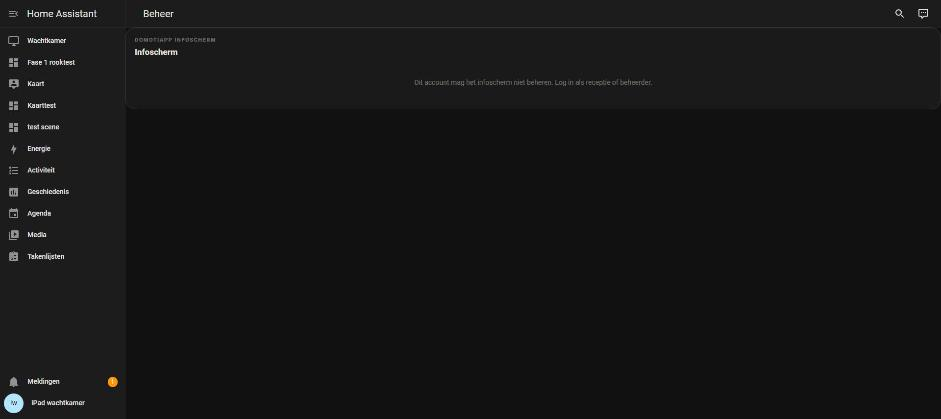
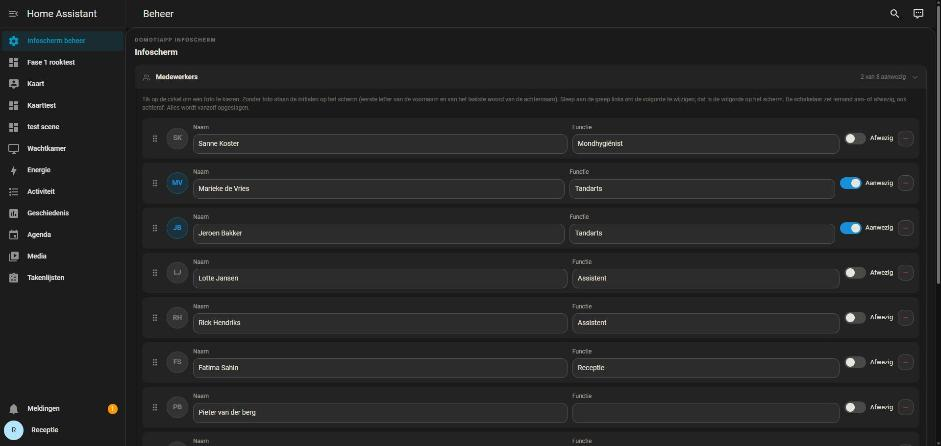

# Het infoscherm beheren als receptie, zonder adminrechten

## De vraag

De eigenaar op 12 oktober 2026:

> *"We hebben nu 2 dashboards normaal en beheer. Het standaard dashboard staat
> normaal op vanwege als de ipad aan de muur opnieuw opstart dat hij
> automatisch dat dashboard opent in kiosk. De receptioniste moet beheer kunnen
> openen. Kan dat dmv gewoon de link van het dashboard? Zonder dat hij of zij
> admin is?"*

Het antwoord was ja, op grond van de bron van Home Assistant 2026.8 en onze
eigen serverregels. Daarna vroeg hij: *"ja test alles maar"*. Dit rapport is
die meting. Er is geen code veranderd.

## De opstelling

In de testinstance (8127), net als bij een klant:

| | |
|---|---|
| dashboard `infoscherm-wachtkamer` | de infoschermkaart, in de zijbalk |
| dashboard `infoscherm-beheer` | de beheerkaart, **niet** in de zijbalk, "Alleen beheerder" uit |
| `dev` | beheerder |
| `Receptie` | gewone gebruiker (groep `system-users`) |
| `iPad wachtkamer` | gewone gebruiker, als kioskaccount aangewezen in de kaarteditor van het beheer |

Elk account in een eigen tabblad op een eigen origin (`localhost`,
`receptie.localhost`, `ipad.localhost`), zodat ze tegelijk ingelogd zijn.
Het inloggen gaat met `dev/inlog_als.py`, zonder dat een wachtwoord of token
in het gesprek komt. Het kioskaccount is niet met de hand gezet: de beheerkaart
in het tabblad van de beheerder stuurde het door (`installatie/sync`).

## Gemeten

### 1. De receptie opent de link

`http://receptie.localhost:8127/infoscherm-beheer/beheer`

| | gemeten |
|---|---|
| ingelogd als | `Receptie`, `is_admin: false` |
| de beheerkaart | getekend, `mag_beheren: true` |
| blokken | alle zeven zichtbaar: Medewerkers, Mededelingen, Verjaardagen, Openingstijden, Indeling, Verlichting, Instellingen en logo |
| melding "mag niet beheren" | geen |
| in haar zijbalk | "Wachtkamer" wel, "Infoscherm beheer" niet (het paneel heeft `show_in_sidebar: false`) |

### 2. Wijzigen, en het scherm werkt vanzelf bij

Alles met echte kliks en toetsaanslagen in het tabblad van de receptie. Het
iPad-tabblad is in die tijd niet herladen (`performance.timeOrigin` bleef
21:33:17).

| wat | invoer | op de server | op het iPad-scherm |
|---|---|---|---|
| mededeling toegevoegd: "Koffie staat klaar bij de receptie" | 34 aanslagen, alle `isTrusted: true`, waarvan 5 spaties (de eerste op `textarea`, `isTrusted: true`) | erbij, als vijfde | "Mededelingen 1 van 3" (was 1 van 2), met de tekst erin |
| lamp Kleur en wit van plek 1 naar plek 3 gesleept | `pointerdown` op de greep en `pointerup`, allebei `isTrusted: true` | aanuit, dim, kleur_en_wit, kleurtemp, rgb | in die volgorde |
| naam van de eerste lamp: "Lamp balie" | 10 aanslagen, alle `isTrusted: true`, met spatie | `aanuit = Lamp balie` | "Lamp balie" |

Het tabblad van de beheerder stond ondertussen ook op het beheer. Dat zette de
volgorde niet terug: de lampen worden daar als verzameling vergeleken (0.62.0).

### 3. Wat de receptie en de iPad op de server mogen

Rechtstreeks op de server, vanuit het tabblad van elk account. De bestandskiezer
van het logo zit in de shadow DOM en is met de browsertool niet te vullen; de
ROUTE erachter is dezelfde.

| | Receptie | iPad (kiosk) |
|---|---|---|
| bestand uploaden (`/api/domotiapp_lovelace/infoscherm/upload`) | 200, opgeslagen met `door: Receptie` | 403 |
| dat bestand weer verwijderen | gelukt | |
| mededelingen opslaan | gelukt (zie 2) | `unauthorized`; alle vijf bleven staan |
| gebruikerslijst (alleen admin) | `unauthorized` | |
| op een naam tikken (aanwezigheid) | | gelukt, met een echte klik (`isTrusted: true`) |

### 4. Het iPad-account op de beheerlink

"Dit account mag het infoscherm niet beheren. Log in als receptie of
beheerder." De blokken staan er niet.



### 5. "Alleen beheerder" aan

Als proef aangezet op het beheerdashboard. Dan:

- bestaat het paneel niet voor de receptie (`hass.panels` heeft het niet);
- stuurt de link haar zonder melding door naar "Thuis" (`/home/overview`);
- ging het tabblad van de iPad, dat op dat moment op de beheerlink stond,
  meteen ook naar "Thuis".

Daarna weer uitgezet.

### 6. Het standaarddashboard

Home Assistant 2026.8 kiest bij het openen van `/` in deze volgorde (uit de
frontend gelezen, en hieronder nagemeten): de keuze in het profiel van de
gebruiker, dan wat een beheerder voor iedereen instelde, dan de browser, dan
"Thuis".

| instelling | Receptie opent `/` | iPad opent `/` |
|---|---|---|
| voor iedereen: Wachtkamer | `/infoscherm-wachtkamer/scherm` | `/infoscherm-wachtkamer/scherm` |
| voor iedereen: Wachtkamer, en de receptie kiest in haar profiel Infoscherm beheer | `/infoscherm-beheer/beheer` | `/infoscherm-wachtkamer/scherm` |
| voor iedereen: niets, alleen het iPad-account heeft Wachtkamer in zijn profiel | `/home/overview` ("Thuis") | `/infoscherm-wachtkamer/scherm` |

De profielkeuze van de receptie is met echte kliks gedaan, in Profiel →
Dashboard. Twee dingen die daarbij opvielen:

- **De keuzelijst toont ook "Infoscherm beheer"**, hoewel dat niet in de
  zijbalk staat.
- **Zodra het beheer haar standaard is, staat het bovenaan in HAAR zijbalk.**
  Voor de anderen niet.



### Opgeruimd

Na de meting zijn de mededeling, de volgorde en de namen van de lampen en de
aanwezigheid teruggezet zoals ze waren. De proefupload is verwijderd. De twee
accounts en de twee dashboards blijven staan voor een volgende keer; ze staan
in CLAUDE.md onder *Testmateriaal*. Het iPad-account houdt de wachtkamer als
eigen standaard, en de instelling voor iedereen staat weer leeg.

## Wat de eigenaar bij een klant doet

1. **Instellingen → Dashboards → het beheerdashboard:** "Alleen beheerder"
   UIT. "Aan zijbalk toevoegen" mag uit; de link werkt dan nog.
2. **De receptie krijgt een eigen account**, een gewone gebruiker, en staat
   NIET bij de kioskaccounts in de kaarteditor van het beheer.
3. **Het scherm als standaard:** het liefst in het profiel van het iPad-account
   (Profiel → Dashboard). Staat het voor iedereen ("Als standaard instellen"),
   dan kiest de receptie in haar eigen profiel het beheer, of gebruikt ze de
   link als bladwijzer.
4. **De receptie beheert vanaf haar eigen pc of telefoon.** Op de iPad zelf
   kan het niet, want daar is het kioskaccount ingelogd.

## Tests

Geen code veranderd, dus geen nieuwe toets. Erbij gekomen is gereedschap:
`dev/inlog_als.py` (inloggen als een ander account van de testinstance), en
in CLAUDE.md de opstelling en wat er gemeten is.

## Samenvatting

- **Een receptie zonder adminrechten kan het beheer openen met de link,** en
  alles doen wat het beheer aanbiedt: mededelingen, lampnamen, slepen,
  uploaden. Het iPad-scherm werkt binnen enkele seconden bij, zonder herladen.
- **Voorwaarden:** "Alleen beheerder" uit op het beheerdashboard, en de
  receptie is geen kioskaccount.
- **Het standaarddashboard kan per account.** Voor het iPad-account de
  wachtkamer, en de receptie houdt haar eigen keuze.
- Het slepen van de lampen als gewone gebruiker stond nog open uit 0.62.0, en
  is hiermee in de browser gemeten.

## Wat niet lukte

- **De bestandskiezer van het logo** is niet met de browsertool te vullen (het
  veld zit in de shadow DOM). De uploadroute is als receptie en als iPad
  rechtstreeks gemeten.
- **kiosk-mode (HACS), de companion-app en Fully Kiosk** staan niet in de
  testinstance. Hoe die de kop en de zijbalk verbergen is niet gemeten; dat
  hoort bij de klant.
- **Een tweede tik op het iPad-scherm landde op een andere naam.** Wie aanwezig
  is schuift naar voren, dus Sanne Koster stond na de eerste tik op een andere
  plek, en de tweede tik op dezelfde plek zette Jeroen Bakker op afwezig. Dat
  is het scherm dat doet wat het hoort; teruggezet via de server.
- Eén tabblad van de beheerder viel uit de tabgroep van de browsertool (valkuil
  48) en kon niet gesloten worden. Het staat nog open in Chrome.

## Aannames

- Het beheerdashboard bij de klant is een eigen dashboard en geen view binnen
  het dashboard van de iPad. Zo beschreef hij het ("2 dashboards").
- De receptie beheert vanaf een eigen toestel.

## git status --porcelain

Vóór de commit:

```
 M CLAUDE.md
?? dev/inlog_als.py
?? docs/receptie-zonder-admin/
```
