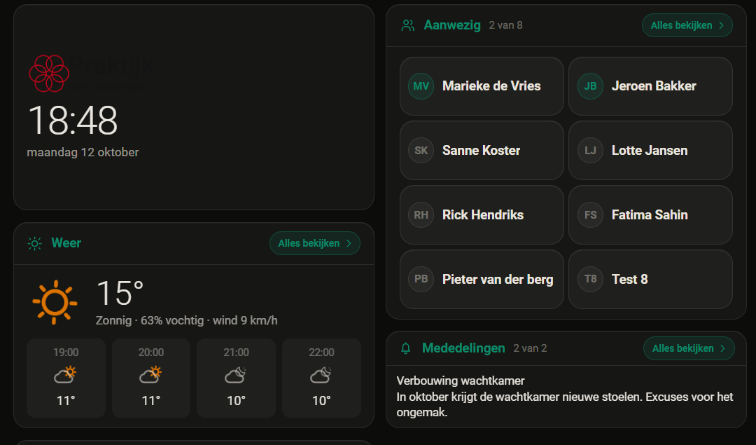

# 0.61.1: het welkomblok krijgt een kader

## De vraag

Via de beheersessie beheer-86, bij een schermafdruk van het infoscherm van een
klant (uiterlijk donker): *"wel wil ik zo'n omtrek om de welkom kaart want nu
past het niet tussen de kaarten snap je?"* Op de vraag of dat een schakelaar
wordt of overal geldt: *"ja alles met kader"*.

Het welkomblok was het enige blok zonder vlak en zonder rand
(`.blok.welkom { background: none; border: none; box-shadow: none }`). Logo en
klok zweefden zo los tussen kaarten die wel een kader hebben.

In dezelfde sessie vroeg hij eerst ook om een aanwezigheidsblok met plaats
voor 20 mensen en zonder "Alles bekijken". Dat trok hij weer in (*"het hoeft
niet meer"*): hij had zelf 20 mensen in de lijst gezet, en zo werkte het al.
Daarvoor is niets gebouwd.

## Wat er veranderd is

| | |
|---|---|
| `.blok.welkom` | hetzelfde vlak, dezelfde rand, dezelfde ronde hoeken en dezelfde schaduw als de andere blokken. Er komt geen kop bij. Het blok meet nog steeds zijn hoogte (`container-type: size`) en zet de inhoud verticaal in het midden. |
| `.blok.welkom .bi` | de marge binnen het blok is 12 bij 16 (× de schaal), net als in elk ander blok. Het was 4 bij 6, en dat is te krap tegen een rand. |
| voorbeeld van het logo in het beheer | staat nu op het VLAK van het welkomblok (`logoOndergrond`): donker `rgb(21, 21, 19)`, licht `rgb(233, 231, 226)`. Tot 0.61.0 was dat de kale achtergrond. De waarschuwing rekent met dezelfde ondergrond. |
| `infoscherm-logo.js` | de donkere kleuren komen rechtstreeks uit de tokens van `theme.js` (`--dac-bg`, `--dac-surface`). Zo staan ze nergens dubbel, en struikelt bewaker 5 niet over een witte tint die geen CSS is. |

## Gemeten in de browser

Testinstance op 8127, Chrome, het tabblad verborgen (de eigenaar werkte in een
ander venster). De geladen `?v=` was `ce449d823863`, gelijk aan de sha256 op
schijf; de config entry is na het bouwen herladen.

Het welkomblok is 2x2, net als bij de klant. Het is 516 x 295 px, met daarin
het bijgesneden logo uit 0.61.0.

| | welkomblok | weerblok ernaast |
|---|---|---|
| licht: vlak | `rgba(20, 20, 10, 0.043)` | `rgba(20, 20, 10, 0.043)` |
| licht: rand | `1px rgba(20, 20, 10, 0.1)` | `1px rgba(20, 20, 10, 0.1)` |
| donker: vlak | `rgba(255, 255, 255, 0.04)` | `rgba(255, 255, 255, 0.04)` |
| donker: rand | `1px rgba(232, 228, 222, 0.1)` | `1px rgba(232, 228, 222, 0.1)` |
| hoek | 20px | 20px |

**Past alles erin?** Gemeten van de onderkant van elk deel tot de binnenkant
van de marge:

| inhoud | logo | klok | tekst |
|---|---|---|---|
| logo, klok, welkomtekst en openingsregel | 186 x 60, 20 px van links | 160 x 87 | 378 x 73, 12,9 px ruimte eronder |
| zoals bij de klant: logo en klok, geen tekst | 186 x 60, 69 px van boven | 160 x 87, 69 px van onder | - |

Met alleen logo en klok staat de inhoud precies in het midden: 69 px erboven
en 69 px eronder.



Het zwarte logo valt op donker weg. Dat is het nagebouwde logo met zwarte
letters, en precies daarvoor waarschuwt het beheer sinds 0.61.0.

## Tests

`npm test`: 1548 groen. `verify`, `check:registratie`, `check:controls` en
`check:css` zijn groen. Python: zie de PR (er is geen Python gewijzigd).

**NIEUW GEDRAG**: in `tests/js/infoscherm-logo.test.mjs` staat het logo op het
vlak van het welkomblok (`logoOndergrond`: `[21, 21, 19]` en `[233, 231, 226]`),
en de donkere waarden komen uit de tokens. Op de code van 0.61.0 faalt dat:
`logoOndergrond` en `SCHERM` bestaan daar niet.

Het kader zelf is CSS en heeft geen unittest (geen jsdom). Het is in de
browser gemeten; zie de tabellen hierboven.

## Samenvatting

Het welkomblok heeft nu overal hetzelfde kader als de andere blokken, met de
gewone marge erbinnen. In 2x2 past alles, met en zonder tekst. Het voorbeeld
van het logo in het beheer staat op dezelfde ondergrond als op het scherm. Het
aanwezigheidsblok is op zijn verzoek niet veranderd.

## Wat niet lukte

- **Een laag welkomblok (2x1) met een breed logo, de klok én een lange tekst
  past niet.** De tekst krijgt 75 px breedte en loopt 57 px buiten het blok.
  Dat is niet nieuw: met de oude marge was die breedte ongeveer 100 px (dat is
  uitgerekend, niet gemeten), en ook dan past "Welkom, neemt u plaats." op
  30 px niet. De klant en de standaardindeling gebruiken 2x2. Niet
  gerepareerd. Wil hij 2x1 met tekst, dan is dat een volgende ronde: de tekst
  kleiner, of het logo smaller in die vorm.
- Een echte iPad: niet gemeten. De beheersessie kijkt het na bij de klant.

## Aannames

- "Zo'n omtrek" is het hele kader van een blok: het vlak, de rand, de ronde
  hoeken en de schaduw. Niet alleen de rand.
- De marge binnenin is die van elk ander blok (12 x 16). De beheersessie vroeg
  om "genoeg lucht"; ik heb geen eigen maat bedacht.

## git status --porcelain

Vóór de commit:

```
 M custom_components/domotiapp_lovelace/frontend/domotiapp-lovelace.js
 M custom_components/domotiapp_lovelace/manifest.json
 M docs/logo-op-het-infoscherm/RAPPORT.md
 M src/cards/infoscherm-beheer-card.js
 M src/cards/infoscherm-card.js
 M src/cards/infoscherm-logo.js
 M tests/js/infoscherm-logo.test.mjs
?? docs/welkomblok-met-kader/
```
